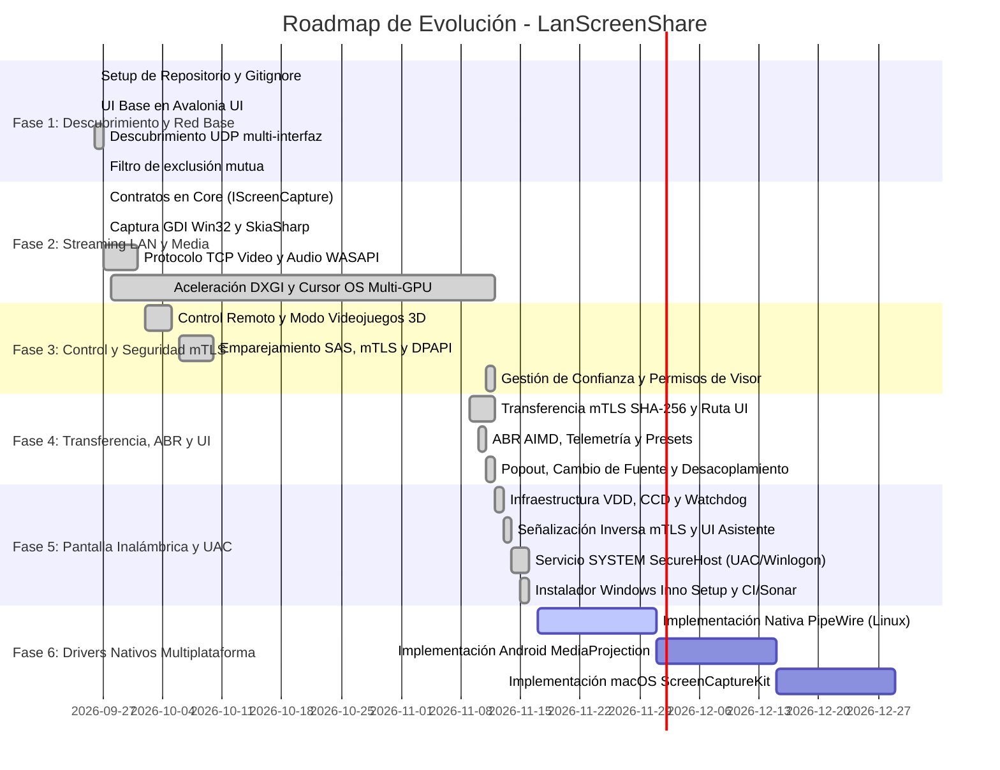

# LanScreenShare - Arquitectura, Roadmap y Diagrama de Clases

Documento de seguimiento técnico, evolución arquitectónica y contratos oficiales del proyecto **LanScreenShare**. Refleja las capacidades implementadas en el repositorio, los contratos de abstracción de red y multimedia, la seguridad criptográfica, la extensión inalámbrica de pantalla y la hoja de ruta multiplataforma.

---

## 1. Visión y Objetivos del Proyecto

- **Objetivo principal:** Aplicación ligera, segura y de alto rendimiento para compartir pantalla, audio del sistema, control remoto, archivos y pantallas virtuales extendidas en redes locales (LAN).
- **Estrategia nativa y aceleración por hardware:**
  - **Windows:** Captura directa GPU mediante DirectX 11 DXGI Output Duplication (con selección multi-GPU por adaptador/salida y renderizado del cursor OS) y Win32 GDI / captura de ventanas. Codificación y decodificación H.264 por Media Foundation con detección dinámica de MFT hardware (NVENC / QuickSync / AMF) y audio de baja latencia mediante WASAPI Loopback y captura por proceso.
  - **Control de congestión y sincronización:** Control adaptativo en tiempo real (**ABR** basado en AIMD en `AdaptiveBitrateController`) y alineación audiovisual (`AudioVideoSyncController`).
- **Modo Pantalla Inalámbrica (Monitor Extendido Virtual):**
  - Creación dinámica de monitor virtual sobre `Virtual-Display-Driver` (o backend `ParsecVDD`), configuración y restauración automática de topología Windows CCD (`WindowsDisplayTopologyManager`), señalización inversa autenticada por mTLS y proceso supervisor independiente (`LanScreenShare.DisplayWatchdog`).
- **Soporte UAC y Escritorio Seguro (Winlogon):**
  - Servicio Windows `LanScreenShare.SecureHost` bajo `NT AUTHORITY\SYSTEM` que lanza agentes por sesión e intercambia vídeo/entradas a través de Named Pipes con ACL de privilegio mínimo.
- **Transferencia Rápida de Archivos:**
  - Canal dedicado sobre mTLS (puerto TCP `5004`), transmisión por bloques de 64 KB, validación de integridad SHA-256, soporte Drag & Drop en UI y carpeta de descarga configurable por el usuario.
- **Seguridad Criptográfica y Control de Acceso:**
  - Autenticación mutua TLS 1.3 / 1.2 (mTLS) con certificados ECDSA P-256, código de verificación SAS de 6 dígitos, tokens atómicos por canal (`ChannelAttachmentToken`), almacén de dispositivos confiables con gestión y revocación desde la UI (`TrustedDevicesWindow`), sincronización de permisos por visor y protección de claves con DPAPI (Windows) o AES-256-GCM (multiplataforma).
- **Diseño Orientado a Multiplataforma:**
  - Interfaz en **Avalonia UI 12.0.2** sobre **.NET 9.0** y desacoplamiento por fábricas abstractas (`CaptureServiceFactory`, `AudioServiceFactory`, `IdentityKeyStorageFactory`).

---

## 2. Tecnologías y Herramientas Utilizadas

| Componente | Tecnología | Justificación y Rol en la Arquitectura |
| :--- | :--- | :--- |
| **Plataforma base** | .NET 9.0 (C# 13) | Alto rendimiento y manejo eficiente de memoria (`Span<T>`, `Memory<T>`, `ArrayPool<byte>`). |
| **Interfaz de Usuario** | Avalonia UI 12.0.2 (Fluent Theme) | Framework XAML multiplataforma con renderizado SkiaSharp y ventanas auxiliares (*popout*, dispositivos confiables, instalador VDD). |
| **Descubrimiento LAN** | Sockets UDP (`DiscoveryService`, puerto `5000`) | Broadcast dirigido por subred con aislamiento de adaptadores virtuales, auto-filtrado y anuncio de capacidad Pantalla Inalámbrica. |
| **Seguridad de Transporte** | TLS 1.3 / 1.2 mTLS (`SslStream`) | Canales cifrados con autenticación mutua ECDSA P-256, pinning de huella SHA-256, verificación SAS y tokens de un solo uso por sesión. |
| **Almacenamiento de Claves** | DPAPI (Win) / AES-256-GCM (Cross-Platform) | Protección en reposo de claves privadas de identidad con permisos estrictos (`0600` fuera de Windows). |
| **Captura GPU y Ventanas** | DirectX 11 DXGI (`Vortice.Direct3D11`) / Win32 GDI | Captura directa desde VRAM, soporte multi-GPU (`DxgiOutputSelector`), renderizado del cursor OS (`CursorSpriteRenderer`) y captura selectiva de ventanas. |
| **Captura Universal** | `CrossPlatformScreenCaptureService` | Implementación desacoplada para compilación y pruebas multiplataforma fuera de Windows. |
| **Códecs de Video** | Media Foundation H.264 (`Vortice.MediaFoundation`) / JPEG (`SkiaSharp`) | Detección de MFT hardware (`HardwareMftEncoderDiscovery`) con fallback explícito a software CPU o JPEG por bloques paralelos. |
| **Streaming de Audio** | WASAPI Loopback / `NAudio.Wasapi` / `NullAudio*` | Captura global del dispositivo, captura por proceso (`ProcessLoopbackAudioCapture`), micrófono y audio nulo seguro multiplataforma. |
| **Control de Congestión (ABR)** | `AdaptiveBitrateController` (AIMD) | Ajuste dinámico de bitrate, escala defensiva de FPS y solicitud automática de fotogramas clave (IDR). |
| **Control Remoto y Escritorio Seguro** | Win32 `SendInput` + `LanScreenShare.SecureHost` | Inyección estándar y relativa 3D, sincronización de portapapeles y operación sobre UAC/Winlogon mediante Named Pipes con ACL. |
| **Pantalla Inalámbrica** | `Virtual-Display-Driver` / `ParsecVDD` + Windows CCD API + `LanScreenShare.DisplayWatchdog` | Creación y ciclo de vida de monitores virtuales, preservación/restauración de topología y limpieza ante fallos del anfitrión. |
| **Transferencia de Archivos** | `TcpFileTransferServer` / `Client` (mTLS, puerto `5004`) | Protocolo binario `LSFT` en bloques de 64 KB con verificación SHA-256 y ruta destino configurable. |
| **Distribución e Instalador** | PowerShell + Inno Setup 6 (`installer\`) | Generación de `LanScreenShare-Setup.exe` con staging self-contained, driver VDD, reglas de firewall y servicio `SecureHost`. |

---

## 3. Estado de Hitos del Roadmap

---

## 4. Resumen Detallado de Módulos Implementados

### 4.1. Transferencia Rápida de Archivos LAN (mTLS - Puerto 5004)
- **Streaming por Bloques:** Implementado en `LanScreenShare.Network/Streaming/TcpFileTransferServer.cs` y `TcpFileTransferClient.cs` con protocolo binario `LSFT`, metadatos JSON y bloques de 64 KB usando `ArrayPool<byte>`.
- **Seguridad e Integridad:** Corre sobre mTLS mutuo validando certificados ECDSA P-256 y verifica el hash SHA-256 completo en emisor y receptor antes de confirmar la entrega.
- **Experiencia de Usuario:** Drag & Drop sobre la ventana principal, progreso en tiempo real, cancelación inmediata y carpeta de descargas configurable desde `MainWindow.FileTransfer.cs` y `AppSettings`.

### 4.2. Control Dinámico de Congestión (ABR) y Sincronización A/V
- **Algoritmo AIMD en Tiempo Real:** Implementado en `LanScreenShare.Core/Services/AdaptiveBitrateController.cs` evaluando RTT, tiempos de codificación y pérdida de tramas.
- **Métricas y Gradientes:**
  - **RTT < 25 ms sin pérdidas:** Incremento aditivo gradual de bitrate hasta el tope configurado.
  - **RTT 25 ms - 50 ms:** Región de estabilidad; mantiene bitrate.
  - **RTT 50 ms - 90 ms:** Reducción preventiva multiplicativa ($\times 0.85$).
  - **RTT > 90 ms o pérdidas sostenidas:** Reducción agresiva ($\times 0.70$), descenso escalonado de FPS (60 -> 45 -> 30) y solicitud inmediata de Keyframe (IDR).
- **Integración en UI:** Telemetría en tiempo real en la barra de estado (`ABR: X Mbps`), perfiles sencillos (`Calidad Alta`, `Equilibrado`, `Red Limitada`) y modo avanzado persistente en `AppSettings`.

### 4.3. Modo Pantalla Inalámbrica (Monitor Extendido Virtual)
- **Backends y Topología (`LanScreenShare.Core/Display` y `LanScreenShare.Media/Display`):** `VirtualDisplayCoordinator` gestiona la máquina de estados del monitor virtual mediante `IVirtualDisplayBackend` (`VirtualDriversVddBackend` y `ParsecVddBackend`) y `WindowsDisplayTopologyManager` (captura de snapshot CCD previo, aplicación de modo Extendido y restauración al finalizar).
- **Señalización Inversa mTLS (`LanScreenShare.Network/Display`):** `DisplaySignalingClient` consulta capacidades en el puerto `5005` y emite una invitación con token efímero para que el receptor conecte de vuelta hacia los servidores mTLS del anfitrión (`VirtualDisplayProjectionHost` <-> `VirtualDisplayProjectionReceiver`).
- **Resiliencia y Asistente:** `LanScreenShare.DisplayWatchdog` monitorea el PID del proceso padre para limpiar monitores virtuales y restaurar pantallas tras un cierre forzado. `VddDriverInstallerWindow` y `VirtualDisplayDriverInstallerService` guían la instalación del driver VDD en Windows.

### 4.4. Soporte Nativo de UAC y Escritorio Seguro (`LanScreenShare.SecureHost`)
- **Aislamiento de Sesión y Desktop Boundary:** Servicio Windows ejecutado bajo `NT AUTHORITY\SYSTEM` (`WindowsServiceDispatcher`, `SessionAgentSupervisor`, `WindowsSystemSessionLauncher`) que detecta cambios hacia `Winlogon` / UAC e instancia un proceso agente con acceso directo al escritorio seguro.
- **Canal IPC Seguro:** `SecureAgentPipeServer` y `SecureAgentClient` se comunican mediante Named Pipes protegidos con ACL de privilegio mínimo (`SecureHostServiceManager`) y sanean las configuraciones de política mediante `SecureDesktopPolicySanitizer`.

### 4.5. Seguridad, Dispositivos Confiables y Multiplataforma
- **Gestión de Confianza y Permisos:** `TrustedDeviceManager`, `JsonPairedDeviceStore` y `TrustedDevicesWindow` permiten listar, inspeccionar y revocar equipos emparejados. Los permisos de visualización, audio y control remoto se sincronizan activamente entre anfitrión y visor.
- **Almacén Criptográfico Agnóstico:** `IdentityKeyStorageFactory` selecciona DPAPI en Windows (`WindowsDpapiIdentityKeyStorage`) y AES-256-GCM con permisos `0600` fuera de Windows (`CrossPlatformIdentityKeyStorage`).
- **Fábricas de Servicios:** `CaptureServiceFactory` y `AudioServiceFactory` proveen fallbacks multiplataforma (`CrossPlatformScreenCaptureService`, `NullAudioCaptureService`, `NullAudioPlayerService`, `NullInputSimulatorService`).

---

## 5. Diagrama de Clases Integral de la Arquitectura

```mermaid
classDiagram
    namespace LanScreenShare_Core {
        class IScreenCaptureService {
            <<interface>>
            +bool IsCapturing
            +int TargetFps
            +int BitrateMbps
            +double ResolutionScale
            +StartCapture(...) void
            +StopCapture() void
            +UpdateSettings(...) void
            +RequestKeyframe() void
            +event FrameCaptured
        }

        class IAudioCaptureService {
            <<interface>>
            +bool IsCapturing
            +StartCapture() void
            +StartCapture(int processId) void
            +StopCapture() void
            +event AudioCaptured
        }

        class IAudioPlayerService {
            <<interface>>
            +bool IsPlaying
            +bool IsMuted
            +float Volume
            +PlayChunk(CapturedAudioChunk) void
            +ClearBuffer() void
            +Stop() void
        }

        class IInputSimulatorService {
            <<interface>>
            +SimulateInput(RemoteInputMessage) void
            +SetTargetSource(CaptureSource) void
            +ReleaseInjectedInputs() void
        }

        class IIdentityKeyStorage {
            <<interface>>
            +GetOrCreateIdentityCertificateAsync() Task~X509Certificate2~
            +ResetIdentityAsync() Task
        }

        class IVirtualDisplayBackend {
            <<interface>>
            +VirtualDisplayBackendCapabilities Capabilities
            +CreateVirtualMonitorAsync(...) Task~VirtualDisplayInstance~
            +DestroyVirtualMonitorAsync(...) Task
        }

        class IDisplayTopologyManager {
            <<interface>>
            +CaptureSnapshot() DisplayTopologySnapshot
            +ApplyExtendTopology(...) bool
            +RestoreSnapshot(DisplayTopologySnapshot) bool
            +EnsureExtendedLayout(string) bool
        }

        class AdaptiveBitrateController {
            +int CurrentBitrateMbps
            +int CurrentFps
            +bool IsAbrEnabled
            +OnFrameSent(long, int) void
            +OnTelemetryReceived(StreamTelemetry) void
        }

        class VirtualDisplayCoordinator {
            +VirtualDisplayState State
            +StartExtendedDisplayAsync(...) Task
            +StopExtendedDisplayAsync(...) Task
            +RecoverOrphanedSessionOnStartupAsync() Task
        }

        class SessionAuthority {
            +TryCreateSessionAsync(...) Task
            +IssueChannelToken(...) ChannelAttachmentToken
            +RevokeSessionAsync(...) Task
        }

        class TrustedDeviceManager {
            +ListPairedDevicesAsync() Task
            +RevokeDeviceAsync(string) Task
        }
    }

    namespace LanScreenShare_Network {
        class DiscoveryService {
            +StartHostingBroadcast() void
            +StartWirelessDisplayBroadcast(int) void
            +StartListening() void
        }

        class TcpStreamServer {
            +StartAsync(int port, CancellationToken) Task
            +BroadcastFrameAsync(CapturedFrame) Task
        }

        class TcpControlServer {
            +StartAsync(int port, CancellationToken) Task
        }

        class TcpFileTransferServer {
            +StartAsync(int port, CancellationToken) Task
        }

        class DisplaySignalingServer {
            +StartAsync(int port, CancellationToken) Task
        }

        class VirtualDisplayProjectionHost {
            +StartProjectionAsync(...) Task
            +RefreshCaptureSourceFromTopology() void
        }
    }

    namespace LanScreenShare_Media {
        class CaptureServiceFactory {
            +Create(CaptureSource, string)$ IScreenCaptureService
        }

        class AudioServiceFactory {
            +CreateAudioCapture()$ IAudioCaptureService
            +CreateAudioPlayer()$ IAudioPlayerService
        }

        class DxgiScreenCaptureService {
            +bool RequireExactTargetMatch
            +StartCapture(...) void
            +StopCapture() void
        }

        class MediaFoundationH264EncoderService {
            +EncodeFrameAsync(...) Task
        }

        class WasapiAudioCaptureService {
            +StartCapture() void
        }

        class VirtualDriversVddBackend
        class WindowsDisplayTopologyManager
        class SecureHostServiceManager
    }

    namespace LanScreenShare_Hosts_y_UI {
        class MainWindow
        class StreamPopoutWindow
        class TrustedDevicesWindow
        class VddDriverInstallerWindow
        class WindowsServiceDispatcher
        class VirtualDisplayWatchdogRunner
    }

    IScreenCaptureService <|.. DxgiScreenCaptureService
    CaptureServiceFactory ..> IScreenCaptureService : crea
    IAudioCaptureService <|.. WasapiAudioCaptureService
    AudioServiceFactory ..> IAudioCaptureService : crea
    IVirtualDisplayBackend <|.. VirtualDriversVddBackend
    IDisplayTopologyManager <|.. WindowsDisplayTopologyManager
    VirtualDisplayCoordinator --> IVirtualDisplayBackend : administra
    VirtualDisplayCoordinator --> IDisplayTopologyManager : aplica CCD
    VirtualDisplayProjectionHost --> VirtualDisplayCoordinator : coordina
    MainWindow --> VirtualDisplayProjectionHost : proyecta
    MainWindow --> AdaptiveBitrateController : sincroniza ABR
    MainWindow --> TrustedDeviceManager : gestiona confianza
    MainWindow --> SecureHostServiceManager : controla UAC/Winlogon
    WindowsServiceDispatcher --> SecureHostServiceManager : atiende IPC SYSTEM
```

---

## 6. Hoja de Ruta para Próximas Fases (Drivers Nativos Multiplataforma)

Con la arquitectura desacoplada mediante fábricas abstractas e interfaces en `LanScreenShare.Core`, el siguiente objetivo es implementar los backends nativos fuera de Windows sin alterar la capa de red ni la interfaz en Avalonia:

1. **Linux (PipeWire / Wayland / X11):**
   - Implementar `PipeWireScreenCaptureService` mediante el portal D-Bus `org.freedesktop.portal.ScreenCast`.
   - Captura de audio del sistema vía PipeWire / PulseAudio loopback.
2. **Android (API 29+):**
   - Implementar `AndroidMediaProjectionService` con `MediaProjection` y `VirtualDisplay` renderizado hacia `Surface`.
   - Gestión de `WifiManager.MulticastLock` en el descubrimiento UDP.
3. **macOS (ScreenCaptureKit):**
   - Implementar `MacScreenCaptureKitService` sobre `SCStream` y `SCContentFilter` para macOS 12.3+.
