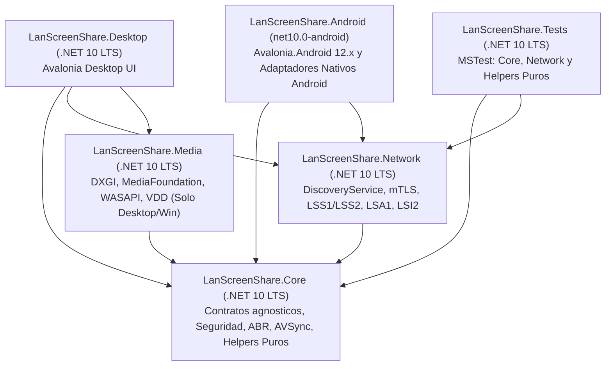
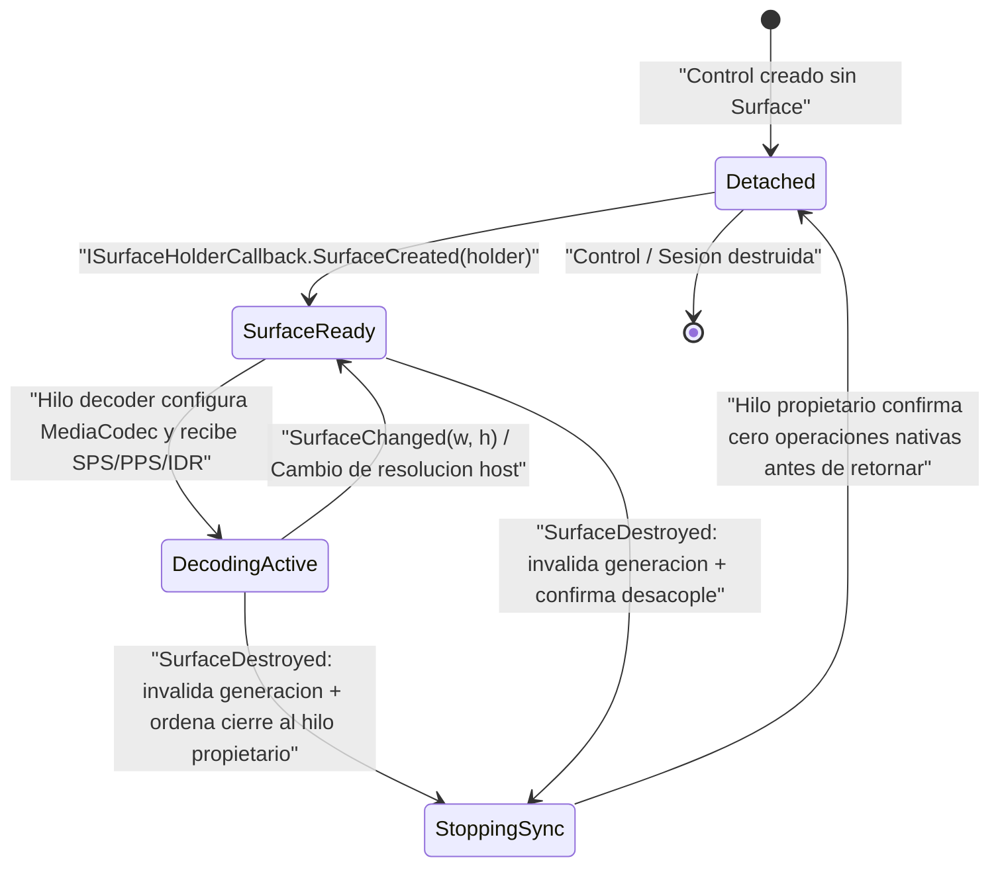

# ADR-003: Arquitectura de LanScreenShare para Android (Emisor y Visor sobre .NET 10 LTS y Avalonia UI)

* **Estado:** Propuesto (Revisión 4)
* **Fecha:** 2026-11-23
* **Módulos afectados:** `LanScreenShare.Core`, `LanScreenShare.Network`, `LanScreenShare.Android` (nuevo), `LanScreenShare.Tests`, `.github/workflows/`
* **Decisores:** Equipo de Arquitectura de LanScreenShare

---

## 1. Contexto, Objetivos, Versiones Objetivo y Protocolos

LanScreenShare cuenta actualmente con una arquitectura desacoplada donde la lógica de dominio, seguridad mTLS/SAS, ABR y sincronización audiovisual reside en `LanScreenShare.Core`, la capa de transporte y protocolos binarios reside en `LanScreenShare.Network`, y las implementaciones nativas de Windows (DXGI, Media Foundation, WASAPI, `SendInput`, VDD/CCD, `SecureHost`) permanecen aisladas en `LanScreenShare.Media`.

Este documento define la arquitectura para incorporar **Android** como plataforma nativa en **LanScreenShare** sobre **.NET 10 LTS** (`net10.0-android`) y **Avalonia UI 12.x** compatible con .NET 10, cerrando la migración a **.NET 10 LTS** como objetivo definitivo de toda la solución (admitiendo únicamente una transición temporal mediante multi-targeting si fuera estrictamente necesaria, sin mantener .NET 9 como objetivo permanente).

### 1.1 Alcance Funcional

* **Fase 1 (Alcance de este ADR):**
  * **Modo Visor (Android <- Host Windows/Android):** Descubrimiento LAN y conexión manual por IP, autenticación mutua mTLS con emparejamiento SAS de 6 dígitos, recepción inicial JPEG (`LSS1`), decodificación posterior H.264 por hardware con renderizado mediante superficie nativa (`LSS2`), reproducción de audio de baja latencia (`LSA1`), chat de voz (`ViewerMicrophone`), sincronización de portapapeles y control remoto saliente (`LSI2`) mediante gestos táctiles y teclas discretas (quedando la inyección directa de texto Unicode IME en el foco como capacidad pendiente fuera de Fase 1).
  * **Modo Emisor (Host Android -> Visor Windows/Android):** Captura de pantalla con `MediaProjection` y un único `VirtualDisplay`, codificación H.264 vía `MediaCodec` interoperable con `MediaFoundationH264DecoderService`, captura de audio interno (`AudioPlaybackCapture`) y micrófono, control ABR (`AdaptiveBitrateController`) y control remoto entrante estrictamente opt-in y acotado.
* **Fase 2 (Fuera del alcance inmediato, arquitectura compatible):**
  * Modo Pantalla Inalámbrica inversa (puerto TCP `5005`, `DisplaySignalingServer` / `DisplaySignalingClient`).
  * Transferencia rápida de archivos (`LSFT`, puerto TCP `5004`).

### 1.2 Invariante de Protocolos de Red

Los protocolos de cable vigentes en `LanScreenShare.Network` se **conservan sin cambios incompatibles**:

* Descubrimiento UDP en puerto `5000` (`LAN_SCREEN_SHARE_HOST|...`).
* Vídeo y sesión en puerto TCP `5001` sobre mTLS (`VideoPacketProtocol`: `LSS1` JPEG, `LSS2` H.264, `LSS0` fin de flujo, `LSSP` permisos, encabezado binario de 32 bytes).
* Audio PCM en puerto TCP `5002` sobre mTLS (`AudioPacketProtocol`: `LSA1`, encabezado de 28 bytes).
* Control remoto en puerto TCP `5003` sobre mTLS (`Lsi2ControlPacket`: `LSI2`, encabezado de 28 bytes).

Cualquier cambio incompatible en el formato de paquetes, handshakes o semántica de canales queda prohibido dentro de este ADR y requerirá un **ADR independiente**.

### 1.3 Política de Versiones Android (API 29–36) y Arquitecturas de CPU (ABI)

| Rango de Versión | Nivel de Soporte | Alcance y Condiciones |
| :--- | :--- | :--- |
| **Android 10 y 11 (API 29–30)** | **Instalación mínima / Condicionado** | `SupportedOSPlatformVersion = 29.0`. Se permite instalar y ejecutar, pero su **compatibilidad queda condicionada a pruebas empíricas**; no se garantiza paridad funcional con versiones recientes (por ejemplo, disponibilidad de `KEY_LOW_LATENCY` introducido en API 30, variantes de `AudioPlaybackCapture`, restricciones de codecs OEM o diferencias en el backend TLS de la plataforma). |
| **Android 12 y 13 (API 31–33)** | **Objetivo estable** | Soporte completo de permisos runtime (`POST_NOTIFICATIONS` en API 33+), `MediaCodec` moderno y `MediaProjection`. |
| **Android 14, 15 y 16 (API 34–36)** | **Objetivo prioritario / Target** | Cumplimiento estricto de `ForegroundService` tipado, consentimiento de un solo uso para `MediaProjection`, restricción de único `VirtualDisplay` por sesión y validación de *Restricted Settings* en `AccessibilityService`. |

**Política de arquitecturas de CPU (ABI):**
* Soportar Android 10 (API 29) como mínimo de sistema operativo **no garantiza compatibilidad con todas las arquitecturas de CPU**.
* **`arm64-v8a` (`android-arm64`)** se define como la **ABI principal** de compilación, pruebas y distribución.
* **`armeabi-v7a` (`android-arm`, ARM32)** queda como **objetivo opcional** sujeto a evaluación posterior de demanda, rendimiento multimedia y tamaño de binario.
* **`x86_64` (`android-x64`)** se utilizará únicamente para ejecución en emuladores durante desarrollo y CI.

### 1.4 Comparativa de Stacks Tecnológicos Evaluados

| Enfoque | Reutilización de `Core`/`Network` | Rendimiento Multimedia y UI | Mantenibilidad y Riesgos |
| :--- | :--- | :--- | :--- |
| **Opción A (Elegida): `.NET 10 LTS` + `Avalonia UI 12.x` (`net10.0-android`)** | **Reutilización directa de lógica de dominio, seguridad, red y contratos multiplataforma de `Core` y `Network`, complementada con adaptadores nativos de plataforma en `LanScreenShare.Android`.** | Alto. Vídeo H.264 mediante superficie nativa (`NativeControlHost` + `SurfaceView` + `MediaCodec`); audio vía `AudioTrack`; UI táctil en Avalonia Fluent. | Unifica lenguaje y pruebas en C#/.NET 10 LTS. Requiere validar en Hito 0 la compatibilidad de dependencias de `Core`/`Network` en Android, `Avalonia.Android` 12.x y `SslStream`. |
| **Opción B: `.NET 10 LTS` + UI nativa AndroidX** | Reutilización de lógica y contratos multiplataforma de `Core`/`Network` con adaptadores nativos. | Alto en vídeo y UI nativa Android. | Introduce un segundo framework de vistas separado de Avalonia UI. |
| **Opción C: Kotlin + Jetpack Compose (Gradle)** | **Sin reutilización directa de código.** Obliga a portar mTLS 1.3/1.2, transcripción SAS, `LSS1`/`LSS2`/`LSA1`/`LSI2`, `SessionAuthority` y ABR. | Óptimo en tamaño de APK e integración Android. | Alto riesgo de divergencia criptográfica y de protocolo entre escritorio y móvil. |

### 1.5 Restricciones de Plataforma Android

1. **Vista única (`ISingleViewApplicationLifetime`):** A diferencia de `LanScreenShare.Desktop` (`IClassicDesktopStyleApplicationLifetime` con ventanas independientes como `MainWindow` y `StreamPopoutWindow`), Android opera con una sola `Activity` principal y toda la navegación y modales residen dentro de `MainShellView`.
2. **Políticas estrictas de `ForegroundService` y `MediaProjection` (API 34+):** Consentimiento explícito de un solo uso por sesión, `StartForeground(...)` previo a `GetMediaProjection(...)`, tipos de servicio separados estrictamente por función activa y **un único `VirtualDisplay` por instancia de `MediaProjection`**.
3. **Audio interno (`AudioPlaybackCapture`, API 29+):** Sujeto a políticas de cada app origen (`android:allowAudioPlaybackCapture="false"`) y contenido DRM.
4. **Identidad de red y descubrimiento:** `Environment.MachineName` suele devolver `"localhost"` en Android y muchas redes Wi-Fi bloquean tráfico broadcast UDP a pesar de `MulticastLock`.
5. **Inyección de entradas sin root:** Android no permite inyección global arbitraria de teclado y ratón como Windows (`SendInput` / `SecureHost`).

---

## 2. Topología de Proyectos, Auditoría de Dependencias y CI/SonarCloud

### 2.1 Diagrama de Dependencias entre Módulos



### 2.2 Auditoría Explícita de Dependencias de `Core` y `Network` para Android

Una revisión estática del código actual en `LanScreenShare.Core` y `LanScreenShare.Network` identifica los siguientes puntos que **deben validarse y, si procede, aislarse** para compilar y ejecutar en `net10.0-android` sin fallos de carga de ensamblados ni problemas de *trimming*:

| Archivo / Paquete Auditado | API / Dependencia Detectada | Impacto en `net10.0-android` | Acción Requerida |
| :--- | :--- | :--- | :--- |
| `LanScreenShare.Core.csproj` + `Security/WindowsDpapiIdentityKeyStorage.cs` | Paquete NuGet `System.Security.Cryptography.ProtectedData` (`10.0.14`) y `ProtectedData.Protect`/`Unprotect` (`[SupportedOSPlatform("windows")]`). | En tiempo de ejecución no se invoca fuera de Windows (`IdentityKeyStorageFactory` usa `OperatingSystem.IsWindows()`), pero el paquete queda transitivamente en el grafo de Android y puede generar advertencias de plataforma o peso innecesario. | Verificar compilación, *trimming* y empaquetado APK en **Hito 0**; si genera fricción o errores en `net10.0-android`, mover `WindowsDpapiIdentityKeyStorage` y `ProtectedData` a `LanScreenShare.Media` o a un proyecto Windows dedicado. |
| `LanScreenShare.Core/Security/SecureDesktopPolicySanitizer.cs` | `using Microsoft.Win32;` y `Registry.LocalMachine` (`[SupportedOSPlatform("windows")]`, protegido con `OperatingSystem.IsWindows()`). | Puede requerir validación de *trimming* y compatibilidad del ensamblado `Microsoft.Win32.Registry` bajo `net10.0-android`. | Auditar en el build Android de **Hito 0**; si el linker o analizadores CA1416/IL fallan, extraer la implementación de registro fuera de `Core` detrás de `IPromptOnSecureDesktopStore`. |
| `LanScreenShare.Core/Security/IdentityCertificateFactory.cs` | `Environment.MachineName` en el `CN=` y carga PKCS#12 con `X509KeyStorageFlags.Exportable \| X509KeyStorageFlags.PersistKeySet`. | `Environment.MachineName` devuelve `"localhost"` en Android; `PersistKeySet` puede tener semántica distinta o fallar según el proveedor criptográfico Android. | Añadir sobrecarga con nombre explícito de dispositivo y validar `X509CertificateLoader.LoadPkcs12` en dispositivo físico durante **Hito 0**. |
| `LanScreenShare.Core/Security/CrossPlatformIdentityKeyStorage.cs` | `Environment.SpecialFolder.UserProfile` y `File.SetUnixFileMode(...)`. | En Android, `UserProfile` no representa el sandbox privado óptimo ni sustituye a `AndroidKeyStore`. | Android no instanciará esta clase; utilizará su adaptador nativo `AndroidKeystoreIdentityKeyStorage`. |
| `LanScreenShare.Core/Models/DeviceInfo.cs` | `OperatingSystem.IsWindows()` en `CanExtendToDevice`. | Seguro en Android (evalúa a `false`). | Mantener sin cambios. |
| `LanScreenShare.Network/DiscoveryService.cs` | `Environment.MachineName` en payload e `IsSelfMessage`, y `NetworkInterface.GetAllNetworkInterfaces()`. | `Environment.MachineName` rompe la auto-exclusión e identificación visible; además, `GetAllNetworkInterfaces()` tiene restricciones de visibilidad en versiones recientes de Android. | Inyectar proveedores opcionales de nombre e IPs/lock en `DiscoveryService` y validar `GetAllNetworkInterfaces()` en Android 10–16 en **Hito 0/1**. |

### 2.3 Reglas de Aislamiento y Contratos en `Core` y `Network`

* **Aislamiento de dependencias:** `LanScreenShare.Android` (`net10.0-android`, `SupportedOSPlatformVersion = 29.0`) **referenciará únicamente** `LanScreenShare.Core` y `LanScreenShare.Network`. **Queda prohibido** referenciar `LanScreenShare.Media` o `LanScreenShare.Desktop` para no arrastrar `Vortice.Direct3D11`, `Vortice.MediaFoundation` ni `NAudio.Wasapi`.
* **Migración cerrada a `.NET 10 LTS`:** Toda la solución migrará a `.NET 10 LTS`. Si algún paquete de escritorio requiere una ventana de transición, se admite temporalmente multi-targeting (`net9.0;net10.0` en `Core`/`Network`), pero **no se mantendrá `.NET 9` como objetivo permanente**.
* **Regla estricta de abstracción en `Core`:** Ningún contrato o modelo en `LanScreenShare.Core` podrá depender ni referenciar tipos de Android (`Android.Views.Surface`, `Android.Media.MediaCodec`, `Android.Content.Context`, etc.).
* **Contratos nuevos y helpers puros en `LanScreenShare.Core`:**
  * Separación estricta entre decodificación por frames CPU (`IVideoDecoderService`) y consumo agnóstico hacia renderizado en superficie nativa (`INativeVideoSurfaceRenderer`, sin exponer `Surface` ni `MediaCodec` en `Core`).
  * Separación de identidades: `IDeviceNameProvider` (nombre visible) e `IDeviceIdentifierProvider` (identificador de instalación), desacoplados de `IIdentityKeyStorage`.
  * `INetworkBroadcastLock`: contrato agnóstico para adquisición/liberación de un mecanismo auxiliar de recepción de tráfico Wi-Fi (sin implicar ni garantizar habilitación de broadcast UDP).
  * Helpers puros testeables en `LanScreenShare.Tests`: `H264AnnexBHelper`, `TouchInputMapper` y `VirtualKeyMapper`.
* **Ajustes retrocompatibles en `LanScreenShare.Network`:** Inyección opcional en `DiscoveryService` de proveedor de nombre visible, resolución de IPs locales/exclusión sin depender del hostname y `INetworkBroadcastLock?`, preservando intactos el datagrama UDP `5000` y el comportamiento en Windows.

### 2.4 Estructura Interna Propuesta para `LanScreenShare.Android`

```text
LanScreenShare.Android/
├── LanScreenShare.Android.csproj
├── AndroidManifest.xml
├── MainActivity.cs
├── App.axaml / App.axaml.cs
├── Platform/
│   ├── Capture/
│   │   ├── AndroidMediaProjectionCaptureService.cs
│   │   └── ScreenCaptureForegroundService.cs
│   ├── Video/
│   │   ├── AndroidMediaCodecSurfaceDecoder.cs
│   │   └── AndroidHardwareVideoSurfaceControl.cs
│   ├── Audio/
│   │   ├── AndroidAudioTrackPlayerService.cs
│   │   ├── AndroidPlaybackAudioCaptureService.cs
│   │   └── AndroidMicAudioCaptureService.cs
│   ├── Input/
│   │   ├── AndroidAccessibilityInputSimulatorService.cs
│   │   └── LanScreenShareAccessibilityService.cs
│   ├── Security/
│   │   └── AndroidKeystoreIdentityKeyStorage.cs
│   └── Network/
│       ├── AndroidDeviceNameProvider.cs
│       ├── AndroidDeviceIdentifierProvider.cs
│       └── AndroidWifiMulticastLock.cs
├── Services/
│   └── AndroidStreamingSessionCoordinator.cs
├── ViewModels/
│   ├── MainShellViewModel.cs
│   ├── DevicesViewModel.cs
│   ├── HostViewModel.cs
│   ├── ViewerViewModel.cs
│   └── SecuritySettingsViewModel.cs
└── Views/
    ├── MainShellView.axaml / .cs
    ├── DevicesView.axaml / .cs
    ├── HostView.axaml / .cs
    ├── ViewerView.axaml / .cs
    └── SecuritySettingsView.axaml / .cs
```

### 2.5 Estrategia de Soluciones, CI y SonarCloud

* **Preservación de `LanScreenShare.sln`:** Los workflows `.github/workflows/ci.yml` y `.github/workflows/sonarcloud.yml` compilan y ejecutan pruebas sobre `LanScreenShare.sln` sin instalar el workload de Android. Por lo tanto, `LanScreenShare.Android.csproj` **NO se agregará a `LanScreenShare.sln`**.
* **Solución dedicada:** Se utilizará `LanScreenShare.Android.sln` (`Core`, `Network`, `Android`, `Tests`) y un workflow independiente `.github/workflows/android-ci.yml` con instalación del workload `android` sobre .NET 10 SDK para compilar el APK de verificación.
* **Cobertura SonarCloud:** La lógica pura compartida (`H264AnnexBHelper`, `TouchInputMapper`, `VirtualKeyMapper`, separación de identidades y ajustes en `DiscoveryService`) vivirá en `Core`/`Network` y estará cubierta por `LanScreenShare.Tests`.

---

## 3. Arquitectura del Modo Visor (Android como Receptor)

### 3.1 Separación Contractual y Ruta Real JPEG (`LSS1`) vs H.264 (`LSS2`)

Verificando la implementación real en `LanScreenShare.Desktop/MainWindow.ClientViewing.cs`:
* `IVideoDecoderService` (`TryDecodeFrame(byte[] encodedData, int width, int height, out DecodedVideoFrame decodedFrame)`) existe actualmente **solo para H.264 en CPU** (`MediaFoundationH264DecoderService` -> `DecodedVideoFrame` -> `WriteableBitmap`). **No existe un servicio JPEG que implemente `IVideoDecoderService`.**
* La ruta real de **JPEG (`LSS1`)** en `MainWindow.ClientViewing.cs` (`HandleJpegFrameReceived`) decodifica directamente `CapturedFrame.Data` mediante **`Avalonia.Media.Imaging.Bitmap(MemoryStream)`** y lo asigna a `Image.Source`.

Para mantener coherencia con el código existente y no introducir tipos Android en `Core`:

| Ruta de Vídeo en Visor | Contrato / Mecanismo Utilizado | Flujo de Datos y Uso en Android |
| :--- | :--- | :--- |
| **JPEG (`LSS1`) — Hito 1 y Fallback** | Ruta directa actual con `Avalonia.Media.Imaging.Bitmap` sobre `Avalonia.Controls.Image` (equivalente a `HandleJpegFrameReceived` en `MainWindow.ClientViewing.cs`), disponiendo de forma explícita los `Bitmap` previos reemplazados. | Decodificación basada en frames CPU sin inventar una interfaz JPEG inexistente bajo `IVideoDecoderService`. Sirve como base del **Hito 1** y como fallback funcional cuando H.264 no esté disponible. |
| **H.264 (`LSS2`) — Hito 2** | Contrato agnóstico en `Core` (`INativeVideoSurfaceRenderer`: recepción de payload codificado, dimensiones, timestamp, `Reset()`, eventos de estado/resolución) implementado por `AndroidMediaCodecSurfaceDecoder`. | **Renderizado mediante superficie nativa** (`AndroidHardwareVideoSurfaceControl` con `NativeControlHost` + `SurfaceView`), evitando la conversión manual NV12->BGRA en CPU y la copia hacia `WriteableBitmap`, **sin garantizar ausencia absoluta de copias** dentro del compositor gráfico del SO o driver del SoC. |

### 3.2 Propiedad, Ciclo de Vida y Sincronización Segura de `Surface`

El renderizado mediante superficie nativa exige evitar deadlocks entre hilo UI e hilo del decodificador, bloqueos indefinidos y operaciones concurrentes sobre `MediaCodec`. Para sostener el ciclo de vida de la `Surface` sin contradicciones, se separan explícitamente **dos condiciones**:

1. **Condición 1 (código administrado — sin nuevos renders):** Al dispararse `ISurfaceHolderCallback.SurfaceDestroyed`, se invalida atómicamente la generación de la superficie para no iniciar ninguna nueva operación de renderizado sobre ella desde el código administrado.
2. **Condición 2 (operación nativa en curso — desacople completo antes de retornar):** `SurfaceDestroyed` no debe retornar hasta que el hilo propietario del decodificador confirme que ya no queda ninguna operación nativa en curso que pueda utilizar la `Surface`.



Reglas de diseño concurrente obligatorias:
1. **Propiedad exclusiva de `Surface`:** `AndroidHardwareVideoSurfaceControl` (`NativeControlHost` + `SurfaceView`) posee la `Surface` y gestiona `ISurfaceHolderCallback` (`SurfaceCreated`, `SurfaceChanged`, `SurfaceDestroyed`). `AndroidMediaCodecSurfaceDecoder` recibe la `Surface` en préstamo mientras es válida y nunca la destruye.
2. **Hilo único propietario de `MediaCodec`:** Todas las operaciones sobre una instancia de `MediaCodec` (`Configure`, `Start`, `QueueInputBuffer`, `DequeueOutputBuffer`, `ReleaseOutputBuffer`, `Flush`, `Stop`, `Release`) se ejecutan exclusivamente en un **único hilo/bucle dedicado del decodificador** (cola acotada de tramas entrantes), eliminando todo acceso concurrente desde el hilo de red TCP o el hilo UI.
3. **Prohibición de espera inversa (anti-deadlock):** El hilo del decodificador **nunca** ejecutará llamadas bloqueantes hacia el hilo UI (`Dispatcher.UIThread.Invoke` síncrono prohibido dentro del bucle de decodificación); toda notificación hacia la UI será asíncrona (`Post`).
4. **Decisión técnica abierta para el cumplimiento determinista de la Condición 2:** Invalidar una generación en código administrado no detiene una llamada nativa de `MediaCodec` que ya haya comenzado. Por ello, **no se permite** retornar de `SurfaceDestroyed` mientras una operación nativa sobre la `Surface` continúe bloqueada. El mecanismo exacto para garantizar que el hilo propietario complete su desacople dentro del presupuesto de respuesta del hilo UI sin provocar ANR (por ejemplo, timeouts cortos de `DequeueInputBuffer`/`DequeueOutputBuffer`, uso de modo asíncrono con `MediaCodec.Callback` o aislamiento del ciclo de salida) queda registrado como **decisión técnica pendiente** y criterio de aceptación verificable en el **Hito 2**.
5. **Orden de capa en Avalonia:** Al usar `SurfaceView`, el control debe ocultarse (`IsVisible = false`) cuando el stream activo sea `LSS1` JPEG o ante modales superpuestos (como el diálogo SAS), evaluando frente a `TextureView` en Hito 2 si se requiere superposición libre de controles flotantes.

### 3.3 Pipeline de Audio (`AudioTrack`) y Chat de Voz (`ViewerMicrophone`)

* **Reproducción (`AndroidAudioTrackPlayerService : IAudioPlayerService`):**
  * Consume `CapturedAudioChunk` desde `TcpAudioClient` (puerto `5002`, `LSA1`).
  * Soporta `AudioFormat = 3` (IEEE Float de `WasapiAudioCaptureService`, mapeado a `Encoding.PcmFloat`) y `AudioFormat = 1` (`Encoding.Pcm16bit`), típicamente a `48000 Hz` estéreo.
  * Utiliza `AudioTrack.Builder` con `AudioTrackMode.Stream` y `AudioTrackPerformanceMode.LowLatency` cuando el dispositivo lo admite.
  * Se coordina con `AudioVideoSyncController` (`DropStaleAudio` y actualización de drift hacia `TcpStreamClient.UpdateAvDrift`).
* **Micrófono del visor (`AndroidMicAudioCaptureService : IAudioCaptureService`):**
  * Captura mediante `AudioRecord` (`AudioSource.VoiceCommunication`) previa concesión del permiso `RECORD_AUDIO`, emitiendo fragmentos `AudioSourceType.ViewerMicrophone` hacia `TcpAudioClient`.

### 3.4 Control Remoto Saliente (`LSI2`, Puerto 5003): Portapapeles vs Escritura Unicode IME

La auditoría del receptor real en Windows (`TcpControlServer.HandleClipboardTextPacketAsync`, `MainWindow.RemoteControl.cs` y `MainWindow.RemoteSourceMenu.ApplyRemoteClipboardText` mediante `topLevel.Clipboard.SetTextAsync`) confirma que **`InputEventType.ClipboardText` únicamente actualiza el portapapeles del sistema remoto y NO inserta texto en el control que tiene el foco**.

En consecuencia, deben distinguirse explícitamente tres operaciones independientes:

1. **Eventos discretos de ratón, teclado y modificadores (`LSI2` vía `TouchInputMapper` y `VirtualKeyMapper`):**
   * Gestos táctiles en modo Directo (coordenadas normalizadas `[0..1]` descontando *letterboxing*) y modo Trackpad relativo (`MouseMove`, `MouseMoveRelative`, `MouseDown`, `MouseUp`, `MouseWheel`).
   * Teclas discretas físicas/virtuales y barra rápida de modificadores (`Ctrl`, `Alt`, `Win`, `Esc`, `Tab`, flechas, `Enter`, `Backspace`, `F1..F12`) traducidas por `VirtualKeyMapper` a Virtual-Keys de Windows (`KeyDown` / `KeyUp`).
2. **Sincronización de portapapeles (`InputEventType.ClipboardText`):**
   * Envía y recibe texto explícitamente hacia/desde el portapapeles remoto cuando `EffectiveSessionPermissions.AllowClipboardSync` está habilitado. No debe confundirse con la escritura de texto en un campo con foco.
3. **Escritura remota de texto Unicode desde teclado virtual Android (IME) — Capacidad pendiente:**
   * Un IME Android emite cadenas Unicode compuestas (`CommitText`, acentos, texto predictivo) que no equivalen 1:1 a códigos Virtual-Key de `LSI2`.
   * Dado que `InputEventType.ClipboardText` en Windows solo actualiza el portapapeles (y ejecutar un pegado automático alteraría el portapapeles previo del usuario anfitrión si no se especifica explícitamente), la **escritura Unicode directa desde IME queda definida como capacidad pendiente**, no resuelta en Fase 1.
   * Cualquier extensión futura para soportar inyección Unicode directa en el foco (o una acción explícita de «enviar y pegar» documentada aparte) deberá especificarse mediante un **ADR independiente** conforme a la Sección 1.2.

---

## 4. Arquitectura del Modo Emisor (Android como Host)

### 4.1 Ciclo de Vida de `MediaProjection` en Android 14+ (Único `VirtualDisplay`)

En Android 14+ (API 34–36), **una misma instancia de `MediaProjection` no debe crear múltiples `VirtualDisplay` ni destruir y recrear el `VirtualDisplay` ante cambios de resolución o rotación**. `AndroidMediaProjectionCaptureService` operará estrictamente con **un único `VirtualDisplay` durante toda la sesión**:

```mermaid
sequenceDiagram
    participant UI as "HostView (Avalonia)"
    participant Act as "MainActivity"
    participant FGS as "ScreenCaptureForegroundService"
    participant MP as "MediaProjectionManager"
    participant Cap as "AndroidMediaProjectionCaptureService"
    participant VD as "Unico VirtualDisplay"
    participant Net as "TcpStreamServer (mTLS 5001)"

    UI->>Act: "Solicita iniciar transmision"
    Act->>MP: "CreateScreenCaptureIntent()"
    MP-->>Act: "OnActivityResult(Result.Ok, intentData)"
    Act->>FGS: "StartForegroundService(intentData + flags de audio)"
    Note over FGS: "Solo TypeMediaProjection si microfono desactivado;<br/>TypeMediaProjection | TypeMicrophone si microfono habilitado"
    FGS->>FGS: "StartForeground(id, notif, tiposActivos)"
    FGS->>MP: "GetMediaProjection(resultCode, intentData)"
    FGS->>Cap: "StartProjection(mediaProjection, profile)"
    Cap->>MP: "RegisterCallback(MediaProjectionCallback)"
    Cap->>Cap: "Selecciona codec via MediaCodecList -> CreateInputSurface()"
    Cap->>VD: "CreateVirtualDisplay(unico, w, h, dpi, inputSurface)"
    loop "Transmision activa"
        Cap-->>Net: "FrameCaptured (H.264 Annex-B con SPS+PPS en IDR)"
    end
    Note over Cap,VD: "Cambio de rotacion o resolucion en la misma sesion:"
    Cap->>Cap: "Crea nuevo MediaCodec encoder (VideoCapabilities) y nueva InputSurface"
    Cap->>VD: "Resize(newW, newH, newDpi)"
    Cap->>VD: "SetSurface(newInputSurface) sobre el VirtualDisplay existente"
    Cap->>Cap: "Libera encoder e InputSurface anteriores; emite nuevo SPS+PPS+IDR"
    Note over FGS,Cap: "Fin de sesion o MediaProjection.Callback.OnStop():"
    Cap->>VD: "Release() unico VirtualDisplay al finalizar sesion"
    FGS->>FGS: "StopForeground(Remove) y StopSelf()"
```

### 4.2 Permisos, Manifiesto, Tipos de `ForegroundService` y Rol de `POST_NOTIFICATIONS`

* **Separación estricta de tipos en `StartForeground(...)`:**
  * **Captura de pantalla (con o sin `AudioPlaybackCapture`):** `ForegroundService.TypeMediaProjection`. **Prohibido** incluir `TypeMicrophone` cuando el usuario no haya habilitado la captura de micrófono.
  * **Captura de pantalla + micrófono habilitado:** requiere permiso runtime `RECORD_AUDIO` previamente concedido y pasa `TypeMediaProjection | TypeMicrophone`.
  * **Chat de voz del visor en segundo plano (si aplica):** servicio independiente con únicamente `ForegroundService.TypeMicrophone`, nunca `TypeMediaProjection`.
  * **Activación dinámica del micrófono durante transmisión activa:** sujeta a prueba técnica en Hito 4 (servicio dedicado de micrófono vs habilitación previa).
* **Obligaciones verificables del manifiesto y flujo de permisos (criterio de aceptación del Hito 4):**
  1. Declarar en `AndroidManifest.xml` los permisos `FOREGROUND_SERVICE`, `FOREGROUND_SERVICE_MEDIA_PROJECTION` y `FOREGROUND_SERVICE_MICROPHONE`.
  2. Declarar en la definición de cada servicio únicamente los `foregroundServiceType` que esa unidad realmente utiliza.
  3. Declarar `RECORD_AUDIO` y verificar su concesión en tiempo de ejecución **antes** de activar la captura de micrófono o pasar `TypeMicrophone`.
  4. Ejecutar `StartForeground(...)` con los tipos activos y obtener `MediaProjection` (`GetMediaProjection(...)`) estrictamente en ese orden.
  5. Verificar explícitamente el escenario donde el usuario concede captura de pantalla (`MediaProjection`) pero **deniega o no activa el micrófono** (la emisión debe iniciar y operar solo con `TypeMediaProjection` sin `SecurityException`).
* **Rol no bloqueante y matiz operativo de `POST_NOTIFICATIONS` (API 33+):**
  * `POST_NOTIFICATIONS` controla únicamente la visibilidad de la notificación al usuario y **no equivale** a los requisitos de consentimiento de `MediaProjection` ni al tipo de `ForegroundService`.
  * **Su denegación no debe bloquear automáticamente la transmisión:** la aplicación solicitará el permiso con justificación clara; si el usuario lo deniega, podrá iniciar y mantener la transmisión mostrando un aviso no bloqueante.
  * **Control de detención cuando la app pasa a segundo plano:** dado que `HostView` no será visible mientras el usuario opera otras aplicaciones, no se debe depender únicamente de un botón en pantalla. El servicio debe conservar una **vía de detención accesible mediante los mecanismos del sistema** (indicador/chip de proyección activa del sistema operativo en Android 14+, controles de servicios activos del sistema y/o acción de notificación cuando esté permitida), y al regresar a primer plano la interfaz debe consultar el estado vivo de `ScreenCaptureForegroundService` para reflejar de inmediato el estado de transmisión y su botón de detención.

### 4.3 Selección Dinámica con `MediaCodecList`, Criterios de Interoperabilidad y Fallback

* **`AndroidMediaProjectionCaptureService : IScreenCaptureService`:**
  * **Detección dinámica mediante `MediaCodecList`:** El selector enumerará los codecs disponibles mediante `MediaCodecList(MediaCodecList.RegularCodecs)` buscando `video/avc`:
    1. Comprueba `CodecCapabilities` (soporte de `ColorFormatSurface` en modo emisor) y `VideoCapabilities`.
    2. Prioriza codificadores acelerados por hardware (`IsHardwareAccelerated` en API 29+) y conserva como respaldo otros codecs `video/avc` compatibles listados por `MediaCodecList`.
    3. Si ningún codificador H.264 resulta utilizable o falla al configurar/validar, **mantiene JPEG (`LSS1`) como fallback funcional** del protocolo.
  * **Alineación y dimensiones según `VideoCapabilities`:** El ancho y alto efectivos se ajustan consultando `VideoCapabilities.WidthAlignment`, `VideoCapabilities.HeightAlignment`, `SupportedWidths`, `SupportedHeights` e `IsSizeSupported(width, height)` del codec seleccionado (usando una alineación conservadora solo si el codec omitiera dichos metadatos).
  * **Configuración preferida y criterios obligatorios de interoperabilidad con `MediaFoundationH264DecoderService`:**
    * Configurar como **preferencia verificada** (no como garantía asumida en cualquier codec OEM) el perfil `AVCProfileBaseline` y `MaxBFrames = 0`, junto con control ABR dinámico (`ParameterKeyVideoBitrate`, `ParameterKeyRequestSyncFrame`).
    * Consultar `MediaCodecList` no demuestra por sí solo compatibilidad con Windows; en **Hito 4** se exigirá validación empírica en dispositivos físicos para:
      1. Confirmar que el codec entrega flujo H.264 realmente decodificable y no solo anunciado como `video/avc`.
      2. Verificar el formato real de los NAL units emitidos y convertir a formato Annex-B si algún codec entregara tramas con prefijo de longitud.
      3. Extraer, conservar y anteponer correctamente `SPS`/`PPS` (`H264AnnexBHelper`) antes de cada `IDR` y ante nuevos visores.
      4. Comprobar que cada cambio de configuración y resolución (`Resize` + `SetSurface`) produce un flujo decodificable sin artefactos ni bloqueo en `MediaFoundationH264DecoderService`.
      5. Verificar en dispositivos físicos el perfil efectivamente negociado, la ausencia de B-frames cuando se solicite y la generación de `IDR` bajo demanda.
* **Audio del emisor:** `AndroidPlaybackAudioCaptureService` (`AudioPlaybackCaptureConfiguration`, API 29+) y `AndroidMicAudioCaptureService` (solo si el usuario habilita micrófono y concede `RECORD_AUDIO`).

### 4.4 Control Remoto Entrante sobre Android: Límites Explícitos de `AccessibilityService`

* **Nivel 0 (Por defecto / Seguro):** `NullInputSimulatorService`. Android anuncia `IsRemoteControlAllowed = false`.
* **Nivel 1 (Opt-in explícito vía `AccessibilityService`):** Solo si el usuario habilita manualmente `LanScreenShareAccessibilityService`.
* **No equivalencia con Windows:** `AccessibilityService` **NO equivale** a la inyección universal de teclado y ratón de Windows (`SendInput` / `SecureHost`):
  * **Soportado de forma limitada:** gestos táctiles vía `DispatchGesture` (`canPerformGestures="true"`) y acciones globales del sistema (`Back`, `Home`, `Recents`).
  * **No soportado:** inyección universal de teclado hardware o modificadores (`Ctrl`/`Alt`/`Shift`), modo relativo 3D para juegos, interacción sobre pantallas protegidas (`FLAG_SECURE`, bloqueo/PIN/biometría, diálogos sensibles del sistema), además de la fricción por *Restricted Settings* en Android 13+ en instalaciones fuera de tienda.

---

## 5. Seguridad Criptográfica, Separación de Identidades y Red

### 5.1 Almacenamiento de Identidad mTLS con `AndroidKeyStore` (`AndroidKeystoreIdentityKeyStorage`)

1. **Alcance y límite real:** `AndroidKeystoreIdentityKeyStorage : IIdentityKeyStorage` protege en `AndroidKeyStore` la **clave simétrica envolvente AES-256-GCM** usada para cifrar el archivo PKCS#12 (`Context.FilesDir/security/identity.pfx.aes`) en reposo, eliminando archivos `.key` en claro en disco.
   * **Aclaración obligatoria:** Esta protección de la clave AES en `AndroidKeyStore` **NO convierte automáticamente la clave privada ECDSA exportada dentro del PFX en una clave no exportable respaldada por hardware**, dado que `SslStream` consume el `X509Certificate2` descifrado en la memoria del proceso.
2. **Validación del proveedor TLS real en `.NET` Android:** No se asume a priori qué backend TLS nativo emplea `.NET 10` en Android ni su comportamiento con `X509CertificateLoader.LoadPkcs12` y mTLS 1.3/1.2. El comportamiento real de `SslStream`, carga de certificados y handshake mutuo constituye un **criterio de aceptación obligatorio en el Hito 0**.
3. **Política de falla segura (ADR-001 Sección 4.1):** Ante error de descifrado o corrupción, nunca se regenera silenciosamente la identidad; se exige confirmación explícita del usuario para restablecerla.
4. **Almacén de dispositivos emparejados:** `JsonPairedDeviceStore` en `Context.FilesDir/security/trusted_devices.json`.

### 5.2 Separación Estricta de Identidades del Dispositivo

LanScreenShare en Android **no dependerá del hostname (`Environment.MachineName`)** para identificarse a sí mismo ni para distinguir dispositivos en la red:

| Concepto | Contrato / Campo | Naturaleza y Ciclo de Vida | Uso Permitido | Uso Prohibido |
| :--- | :--- | :--- | :--- | :--- |
| **1. Nombre visible (`DisplayName`)** | `IDeviceNameProvider` | Etiqueta humana (`Settings.Global.DeviceName` / `Build.Model`). Mutable y no única. | Mostrar en UI y tarjetas SAS. | Seguridad, revocación o detección `IsSelfMessage`. |
| **2. Identificador de instalación (`DeviceId`)** | `IDeviceIdentifierProvider` (`PairedDevice.DeviceId`) | **Identificador de instalación** (UUID v4 generado al primer arranque y guardado en almacenamiento privado de la app). **No es un identificador permanente del hardware** (cambia si se desinstala la app o se borran datos). | Correlación local de registros de instalación en `JsonPairedDeviceStore` y diagnóstico local. | Sustituto de autenticación criptográfica o rastreo permanente de hardware. |
| **3. Identidad criptográfica (`PublicKeyFingerprint`)** | `IIdentityKeyStorage` + `PairedDevice.PublicKeyFingerprint` | Huella canónica `SHA256:HEX` del certificado ECDSA P-256 (ADR-001). | Única fuente de verdad para pinning mTLS, derivación SAS, confianza y revocación. | Asumir persistencia tras restablecimiento de identidad o reinstalación. |

### 5.3 Descubrimiento UDP, `MulticastLock` y Conexión Manual por IP

* `AndroidWifiMulticastLock : INetworkBroadcastLock` adquiere `MulticastLock` (`SetReferenceCounted(false)`) únicamente durante la escucha/anuncio activo y lo libera al detenerse o pausarse.
* **Límite explícito de `MulticastLock`:** `WifiManager.MulticastLock` **no equivale a habilitar broadcast UDP ni garantiza la recepción de los datagramas UDP broadcast usados por `DiscoveryService`**. El contrato `INetworkBroadcastLock` queda definido estrictamente como un **mecanismo auxiliar de recepción de tráfico en Wi-Fi**, no como garantía de descubrimiento (redes con *AP Isolation*, routers restrictivos o ahorro de energía OEM pueden seguir bloqueando el broadcast).
* La **conexión manual por IP** debe mantenerse completamente independiente y operativa como ruta de primera clase desde el Hito 1, incluso cuando el descubrimiento UDP falle por completo.

---

## 6. Diseño de Interfaz Móvil en Avalonia UI 12.x (`ISingleViewApplicationLifetime`)

Vistas móviles dedicadas dentro de `LanScreenShare.Android` (sin reutilizar `MainWindow.axaml` de escritorio):

1. **`MainShellView`:** Contenedor principal (`ISingleViewApplicationLifetime`) con pestañas **Dispositivos**, **Transmitir** y **Seguridad**, más capa modal para SAS y visor inmersivo.
2. **`DevicesView`:** Campo de conexión manual por IP + búsqueda UDP `5000` + listado de dispositivos.
3. **`ViewerView`:** Pantalla completa (`KeepScreenOn` mientras transmite), alojando `Image` con `Avalonia.Media.Imaging.Bitmap` (JPEG `LSS1`, Hito 1 y fallback) y `AndroidHardwareVideoSurfaceControl` (`SurfaceView`, Hito 2+), gestos táctiles, barra rápida de modificadores/teclas discretas `LSI2`, botón dedicado de portapapeles (`ClipboardText`), audio/micrófono y telemetría.
4. **`HostView`:** Perfil/calidad, toggles independientes de audio interno, micrófono (gobierna `TypeMicrophone` y `RECORD_AUDIO`) y control remoto opt-in (Accesibilidad), botón `Transmitir mi pantalla` (no bloqueado si se deniega `POST_NOTIFICATIONS`) y sincronización automática con el estado vivo de `ScreenCaptureForegroundService` al volver a primer plano, además de gestión de visores.
5. **`SecuritySettingsView` y Modal SAS:** Huella SHA-256, restablecimiento explícito, dispositivos confiables (`TrustedDeviceManager`) y confirmación SAS de 6 dígitos.

---

## 7. Plan de Implementación por Hitos

### Hito 0: Validación Técnica y Criterios de Aceptación Fundacionales
* **Objetivo:** Verificar en hardware real todas las hipótesis críticas de plataforma antes de construir la aplicación completa.
* **Criterios de salida obligatorios:**
  1. **APK ejecutable en dispositivo Android 10 (API 29) físico** compilado con `net10.0-android` (ABI principal `arm64-v8a`) y `Avalonia.Android` 12.x.
  2. **Verificación de dependencias multiplataforma** de `LanScreenShare.Core` y `LanScreenShare.Network` en `net10.0-android` (confirmando comportamiento de compilación, *trimming* y ejecución respecto a `ProtectedData`, `Microsoft.Win32.Registry`, `IdentityCertificateFactory` y `NetworkInterface.GetAllNetworkInterfaces()`).
  3. **Conexión TCP** real desde el dispositivo Android 10 físico hacia `LanScreenShare.Desktop` en Windows.
  4. **Handshake mTLS** exitoso sobre `SslStream` (validando el proveedor TLS nativo real de `.NET 10` Android con certificados ECDSA P-256 y carga PKCS#12 en ambos sentidos requeridos).
  5. **Certificate Pinning** verificado (rechazo de certificado desconocido/revocado y aceptación tras emparejamiento).
  6. **Emparejamiento SAS de 6 dígitos** verificado entre Windows y Android comprobando paridad bit a bit de la transcripción canónica (ADR-001).
  7. Definición definitiva de la estrategia de transición de toda la solución a `.NET 10 LTS`.

### Hito 1: Visor Android Mínimo (mTLS/SAS + IP Manual/UDP + JPEG `LSS1`)
* Contratos agnósticos en `Core` (`IDeviceNameProvider`, `IDeviceIdentifierProvider`, `INetworkBroadcastLock`, `INativeVideoSurfaceRenderer`), ajustes retrocompatibles en `DiscoveryService` e `IdentityCertificateFactory`.
* Esqueleto `LanScreenShare.Android` (`net10.0-android`) y `LanScreenShare.Android.sln`, `AndroidKeystoreIdentityKeyStorage`, `DevicesView` (IP manual + UDP `5000`), modal SAS, `SecuritySettingsView` y `ViewerView` renderizando **JPEG (`LSS1`)** mediante `Avalonia.Media.Imaging.Bitmap` sobre `Image`.

### Hito 2: Decodificación H.264 Hardware sobre Superficie Nativa (`LSS2`)
* `H264AnnexBHelper` en `Core` con pruebas unitarias en `LanScreenShare.Tests`.
* `AndroidHardwareVideoSurfaceControl` (`NativeControlHost` + `SurfaceView`) con hilo único propietario de `MediaCodec`.
* Criterio de aceptación de `SurfaceDestroyed`: cerrar la **decisión técnica pendiente** de la Sección 3.2 y validar empíricamente en rotaciones y minimizados repetidos que la Condición 1 y la Condición 2 se cumplen (cero operaciones nativas pendientes al retornar `SurfaceDestroyed`, sin deadlocks ni ANR).
* `AndroidMediaCodecSurfaceDecoder : INativeVideoSurfaceRenderer` con selección mediante `MediaCodecList`, manejo de `SPS`/`PPS`/cambios de resolución y fallback funcional a JPEG `LSS1`.

### Hito 3: Audio (`LSA1`), Portapapeles y Control Remoto del Visor (`LSI2`)
* `AndroidAudioTrackPlayerService` + `AudioVideoSyncController` y `AndroidMicAudioCaptureService` (`ViewerMicrophone`).
* `TouchInputMapper` (Directo/Trackpad), `VirtualKeyMapper` (teclas discretas/modificadores `LSI2`) y sincronización explícita de portapapeles (`ClipboardText`), dejando documentada la inyección de texto Unicode IME en foco como capacidad pendiente fuera de Fase 1.

### Hito 4: Modo Emisor Android (`MediaProjection` + `MediaCodec` + Audio Emisor)
* Verificar cumplimiento estricto de manifiesto y permisos: `FOREGROUND_SERVICE`, `FOREGROUND_SERVICE_MEDIA_PROJECTION`, `FOREGROUND_SERVICE_MICROPHONE`, tipos declarados en servicio, concesión previa de `RECORD_AUDIO` para micrófono, secuencia `StartForeground` -> `GetMediaProjection`, y escenario con captura concedida sin micrófono.
* Verificar manejo no bloqueante de `POST_NOTIFICATIONS`, vía de detención accesible mediante mecanismos del sistema en segundo plano y resincronización de `HostView` al volver a primer plano.
* `AndroidMediaProjectionCaptureService` con **único `VirtualDisplay`** (`Resize` + `SetSurface`), selección vía `MediaCodecList`, tamaños según `VideoCapabilities`, validación de interoperabilidad H.264 real con Windows (NAL/Annex-B, `SPS`/`PPS`, perfil negociado, B-frames, `IDR`), ABR dinámico y fallback funcional a JPEG `LSS1`.
* `AndroidPlaybackAudioCaptureService` (API 29+) y `HostView`.

### Hito 5: Endurecimiento, Accesibilidad Opt-In Acotada, CI y Preparación Fase 2
* `LanScreenShareAccessibilityService` acotado a gestos/acciones globales.
* Workflow `.github/workflows/android-ci.yml`, evaluación de ABI `armeabi-v7a` opcional, ejecución completa de la matriz Android 10–16 y preparación de Fase 2 (`5005` / `5004`).

---

## 8. Matriz de Pruebas Android 10–16 (API 29–36)

| Rango / Nivel | Estado de Soporte | Compatibilidad Funcional | Capacidades Multimedia | Rendimiento y Estabilidad |
| :--- | :--- | :--- | :--- | :--- |
| **Android 10–11 (API 29–30)** | **Condicionado a pruebas** (sin paridad garantizada; `arm64-v8a` principal) | Arranque APK en dispositivo físico Android 10; `AndroidKeyStore` AES-GCM; `SslStream` mTLS, pinning y SAS; conexión IP manual y UDP `5000`; `MediaProjection` pre-API 34. | Visor `LSS1` JPEG; visor `LSS2` H.264 comprobando ausencia/soporte de `KEY_LOW_LATENCY`; `AudioTrack` `PcmFloat` vs `Pcm16bit`; selección `MediaCodecList` y fallback a `LSS1` si aplica. | Medición de FPS reales (sin asumir 60 FPS), latencia y estabilidad de memoria/rotación en hardware antiguo. |
| **Android 12–13 (API 31–33)** | **Objetivo estable** (`arm64-v8a`) | Solicitud de `POST_NOTIFICATIONS` (API 33) verificando que su denegación no bloquea transmisión y conserva detención por sistema/retorno a primer plano; `RECORD_AUDIO`; *Restricted Settings* en `AccessibilityService`; `MulticastLock` + IP manual independiente. | Visor `LSS1` y `LSS2` H.264 por superficie nativa; emisión `MediaProjection` + `MediaCodec` (`MediaCodecList` + `VideoCapabilities`); audio interno + micrófono bidireccional. | Objetivo de 60 FPS en dispositivos de referencia a 1080p bajo Wi-Fi estable; drift A/V controlado; 0 crashes ni ANR en `SurfaceDestroyed` tras rotaciones repetidas. |
| **Android 14–15 (API 34–35)** | **Objetivo prioritario** (`arm64-v8a`) | Consentimiento `MediaProjection` de un solo uso; `StartForeground` previo a `GetMediaProjection`; manifiesto y tipos separados (`TypeMediaProjection` sin `TypeMicrophone` si no hay micrófono, y prueba con pantalla concedida sin micrófono). | Único `VirtualDisplay` con `Resize` + `SetSurface` ante rotaciones sin pérdida de proyección; interoperabilidad real con Windows (NAL/Annex-B, `SPS+PPS+IDR`, perfil negociado y B-frames). | Sesión continua Visor y Emisor >= 15 minutos con adaptación ABR bajo congestión; estabilidad térmica y consumo de batería aceptables. |
| **Android 16 (API 36)** | **Target / Forward** (`arm64-v8a`) | Validación de comportamiento en API 36 (emulador/dispositivo), servicios en primer plano, bordes/insets y permisos runtime. | Verificación de `MediaCodecList`, superficie nativa `SurfaceView`, `AudioTrack` y único `VirtualDisplay` (`Resize`/`SetSurface`). | Sin regresiones de estabilidad, latencia de entrada `LSI2` ni reconexión mTLS respecto a Android 14–15. |

---

## 9. Matriz de Riesgos y Decisiones Cerradas vs Abiertas

### 9.1 Matriz de Riesgos Técnicos

| Riesgo | Impacto | Mitigación y Estado |
| :--- | :--- | :--- |
| **Dependencias Windows en `Core` (`ProtectedData`, `Registry`, `PersistKeySet`) al compilar/linkear en Android** | Fallo de build, *trimming* o excepción en runtime en `net10.0-android`. | Auditoría explícita y verificación en dispositivo Android 10 en **Hito 0**; desacoplar hacia proyecto Windows si generan fricción. |
| **Comportamiento del backend TLS de `.NET 10` Android en `SslStream` mTLS 1.3/1.2** | Fallo de handshake con `LanScreenShare.Desktop` o carga PKCS#12. | Criterio de aceptación obligatorio en **Hito 0** sin suposiciones previas sobre el backend subyacente. |
| **Clave privada ECDSA en memoria del proceso tras descifrar el PFX** | Posible extracción si el dispositivo está comprometido a nivel de proceso/root. | Riesgo residual aceptado (alineado con ADR-001 Sección 2.2); `AndroidKeyStore` protege la clave AES envolvente en reposo. |
| **Deadlock, ANR o uso tras destrucción en `SurfaceDestroyed` de `SurfaceView`** | Crash nativo o congelamiento del hilo UI al rotar o minimizar. | Hilo único propietario de `MediaCodec`, prohibición de espera síncrona hacia UI y decisión técnica pendiente en Hito 2 para cumplir ambas condiciones de desacople dentro del presupuesto del hilo UI. |
| **Restricciones de `VirtualDisplay`, manifiesto y `ForegroundService` en Android 14–16** | `SecurityException` al rotar, al iniciar sin micrófono o por omisión en manifiesto. | Único `VirtualDisplay` (`Resize` + `SetSurface`), verificación obligatoria de manifiesto/permisos en Hito 4 y vía de detención por sistema si `POST_NOTIFICATIONS` fue denegado. |
| **Variabilidad de codecs `MediaCodec` OEM e incompatibilidad con `MediaFoundationH264DecoderService`** | Flujo `video/avc` anunciado pero no decodificable en Windows, B-frames inesperados o pérdida de `SPS`/`PPS`. | Descubrimiento por `MediaCodecList`, tamaños según `VideoCapabilities`, preferencia verificada (`AVCProfileBaseline`, `MaxBFrames = 0`), conversión Annex-B si aplica, pruebas físicas de `Resize` + `IDR` y fallback funcional a JPEG `LSS1`. |
| **Fallo de broadcast UDP pese a `MulticastLock` y menor rendimiento en dispositivos no de referencia** | Lista vacía en UDP `5000` o FPS por debajo de 60. | `INetworkBroadcastLock` acotado como auxiliar de recepción Wi-Fi; conexión manual por IP independiente desde Hito 1; 60 FPS como objetivo en dispositivos de referencia con ABR. |
| **Límites de `AccessibilityService` y ausencia de entrada Unicode IME remota** | Expectativa errónea de control total tipo Windows o confusión de `ClipboardText` con escritura en foco. | Alcance de `AccessibilityService` acotado en Sección 4.4; `ClipboardText` documentado solo como portapapeles; escritura Unicode IME diferida a ADR independiente. |

### 9.2 Decisiones Cerradas

1. **Migración definitiva a `.NET 10 LTS`** para toda la solución (`net10.0` / `net10.0-android`) y **Avalonia UI 12.x** (`ISingleViewApplicationLifetime`). Se permite multi-targeting temporal únicamente si es estrictamente necesario durante la transición, nunca mantener `.NET 9` de forma permanente.
2. Versión mínima de instalación **Android 10 (API 29)** con soporte condicionado a pruebas en Android 10–11; **`arm64-v8a` como ABI principal** y `armeabi-v7a` opcional.
3. Reutilización de lógica y contratos multiplataforma de `LanScreenShare.Core` y `LanScreenShare.Network` con adaptadores nativos en `LanScreenShare.Android`, prohibiendo dependencias hacia `LanScreenShare.Media` y `LanScreenShare.Desktop` y prohibiendo tipos Android en `Core`.
4. Conservación íntegra de los protocolos `LSS1`, `LSS2`, `LSA1` y `LSI2` (cualquier cambio incompatible requiere un ADR independiente).
5. Separación entre decodificación basada en frames CPU (incluyendo ruta real JPEG `LSS1` con `Avalonia.Media.Imaging.Bitmap` sobre `Image`) y renderizado mediante superficie nativa (`INativeVideoSurfaceRenderer` en `Core`), separando las condiciones de invalidación administrada y desacople nativo completo antes de retornar `SurfaceDestroyed`.
6. Emisor Android 14+ con **único `VirtualDisplay`** (`Resize` + `SetSurface`), selección de codecs mediante `MediaCodecList` + `VideoCapabilities`, fallback funcional a JPEG `LSS1`, separación estricta de manifiesto/tipos de `ForegroundService` y rol no bloqueante de `POST_NOTIFICATIONS` con vía de detención accesible por el sistema y resincronización en primer plano.
7. Separación entre `DisplayName`, `DeviceId` (identificador de instalación, no de hardware) y `PublicKeyFingerprint` (identidad criptográfica), sin depender del hostname; `INetworkBroadcastLock` como auxiliar Wi-Fi y conexión manual por IP independiente ante fallos del UDP `5000`.
8. Distinción estricta entre eventos discretos `LSI2`, sincronización de portapapeles (`ClipboardText`) y escritura de texto Unicode IME (capacidad pendiente sujeta a ADR futuro), junto con alcance acotado para `AccessibilityService` opt-in.
9. Aislamiento de `LanScreenShare.Android` en `LanScreenShare.Android.sln` y workflow propio, sin romper `LanScreenShare.sln`.

### 9.3 Decisiones Abiertas (Pendientes de Prueba Técnica en Hito 0–4)

1. **Mecanismo de transición a `.NET 10 LTS` (Hito 0):** migración directa en un paso de toda la solución vs multi-targeting temporal en `Core`/`Network` durante la actualización de paquetes Windows.
2. **Desacople físico de `ProtectedData` / `Registry` en `Core` (Hito 0):** confirmar tras compilar y ejecutar en Android 10 si `WindowsDpapiIdentityKeyStorage` y `SecureDesktopPolicySanitizer` pueden convivir bajo guards o deben extraerse fuera de `Core`.
3. **Comportamiento real de `SslStream`, `LoadPkcs12` y `Avalonia.Android` 12.x (Hito 0 y Hito 2):** validación empírica en Android 10 físico y evaluación de `SurfaceView` vs `TextureView` bajo overlays Avalonia.
4. **Mecanismo exacto de desacople determinista en `SurfaceDestroyed` ante llamadas nativas bloqueadas de `MediaCodec` (Hito 2):** definir y validar en hardware (timeouts cortos de dequeue, modo asíncrono `MediaCodec.Callback` o equivalente) cómo garantizar la Condición 2 sin ANR en el hilo UI.
5. **Activación dinámica de micrófono durante una proyección ya iniciada en Android 14–16 (Hito 4):** definir tras prueba técnica si requiere servicio dedicado de micrófono o habilitación previa al arranque de `ScreenCaptureForegroundService`.
6. **Soporte futuro de escritura Unicode IME en foco (post-Fase 1):** diseño de protocolo mediante ADR independiente si se requiere inserción directa de texto sin alterar el portapapeles remoto.
7. **Evaluación opcional de `armeabi-v7a` (ARM32) y Fase 2:** decidir tras estabilizar `arm64-v8a` si se distribuye APK ARM32, canal de distribución (GitHub Releases vs Play Store) y diseño de Fase 2 (`5005` / `5004`).
